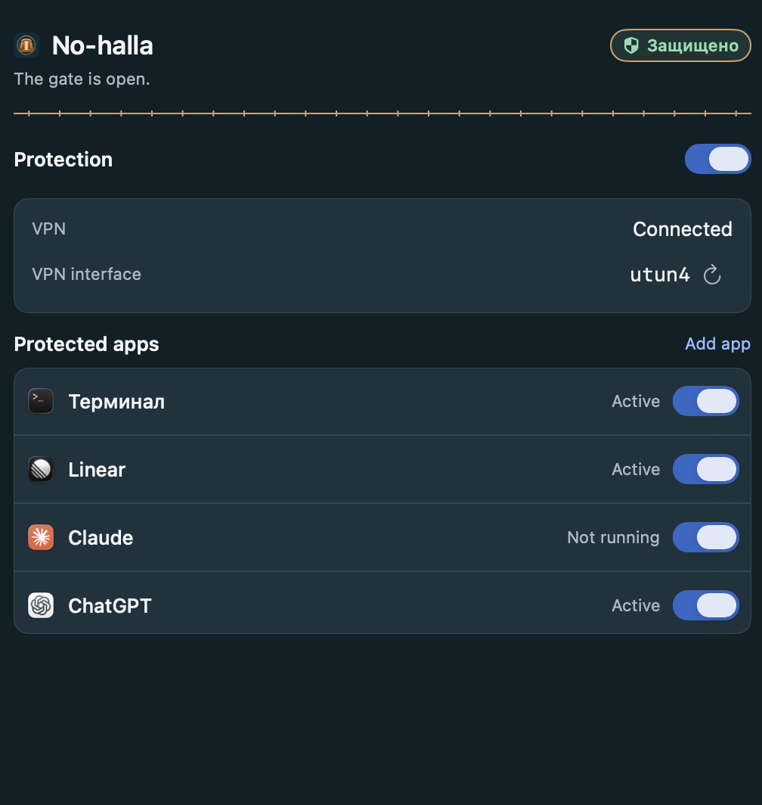
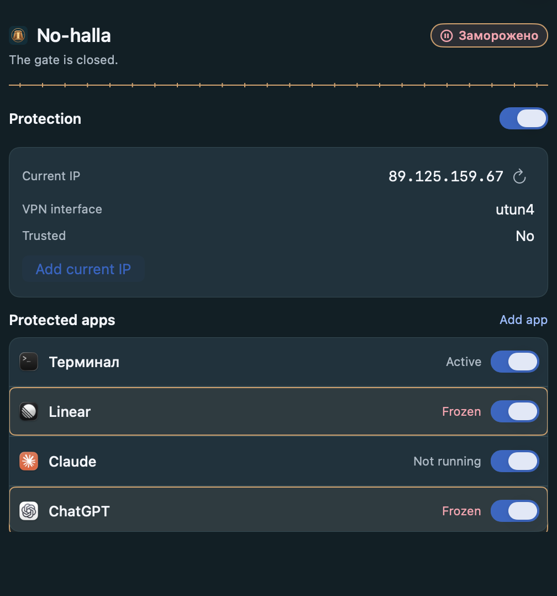

**English** · [Русский](README.ru.md)

# No-halla

*Valhalla can wait.*

**When your VPN drops, No-halla can pause a whole Mac app or just the terminal sessions running AI agents.** Say you have Codex working in Orca and Claude Code in macOS Terminal. Enable **Agent terminals** for both apps and those sessions pause together, including the commands the agents started. A build or SSH session in another tab keeps running. When the VPN returns, both agents resume.

**[Download No-halla 0.9.0](https://github.com/Salesao/No-halla/releases/download/v0.9.0/No-halla-0.9.0.dmg)** · [First launch](#first-launch) · [Build from source](docs/USER_GUIDE.md#build-from-source) · [Troubleshooting](docs/USER_GUIDE.md#troubleshooting)

## Protection in action

| VPN connected | Public IP outside the trusted list |
| :--- | :--- |
|  |  |

## Install

Open the DMG, drag **No-halla** to **Applications**, then open it. Version 0.9.0 runs on **macOS 13 or later**, on Apple silicon and Intel. The download is ad-hoc signed. If macOS asks for approval, use **System Settings → Privacy & Security**. [ZIP](https://github.com/Salesao/No-halla/releases/download/v0.9.0/No-halla-0.9.0.zip) · [SHA-256 checksums](https://github.com/Salesao/No-halla/releases/download/v0.9.0/SHA256SUMS.txt)

## First launch

1. **Choose what pauses for each app.** Select **App** to freeze the whole Claude desktop app. To protect a CLI agent, add the app you run it in, such as Orca or macOS Terminal, and select **Agent terminals**. [Supported agents](docs/USER_GUIDE.md#terminal-agents)
2. **Choose what you trust.** **VPN tunnel** (default) watches for an active tunnel on your Mac. Choose **IP whitelist** if you need a specific public IPv4 address or range. Connect to your VPN before selecting **Trust this IP**.
3. **Finish setup.** Skip **Blocked sites** for app-only protection. Open the menu bar icon or the Dock window to see the result. To try it, disconnect and reconnect your VPN with a selected app open. In VPN tunnel mode you should see **Frozen**, then **Protected**.

**What a pause covers.** No-halla uses `SIGSTOP` to pause user-space execution. macOS can still send buffered data or finish existing connections, and an AI request already sent can finish on the server. Packet-level blocking requires a firewall.

For site blocking, the 0.9.0 package includes the helper that blocks a domain and its subdomains through the system proxy. Existing connections and apps that ignore the proxy can bypass it. [Site blocker setup](docs/USER_GUIDE.md#blocked-sites) · [Recovery and privacy](docs/USER_GUIDE.md#recovery-and-privacy) · [Removal](docs/USER_GUIDE.md#removal) · [MIT license](LICENSE)
