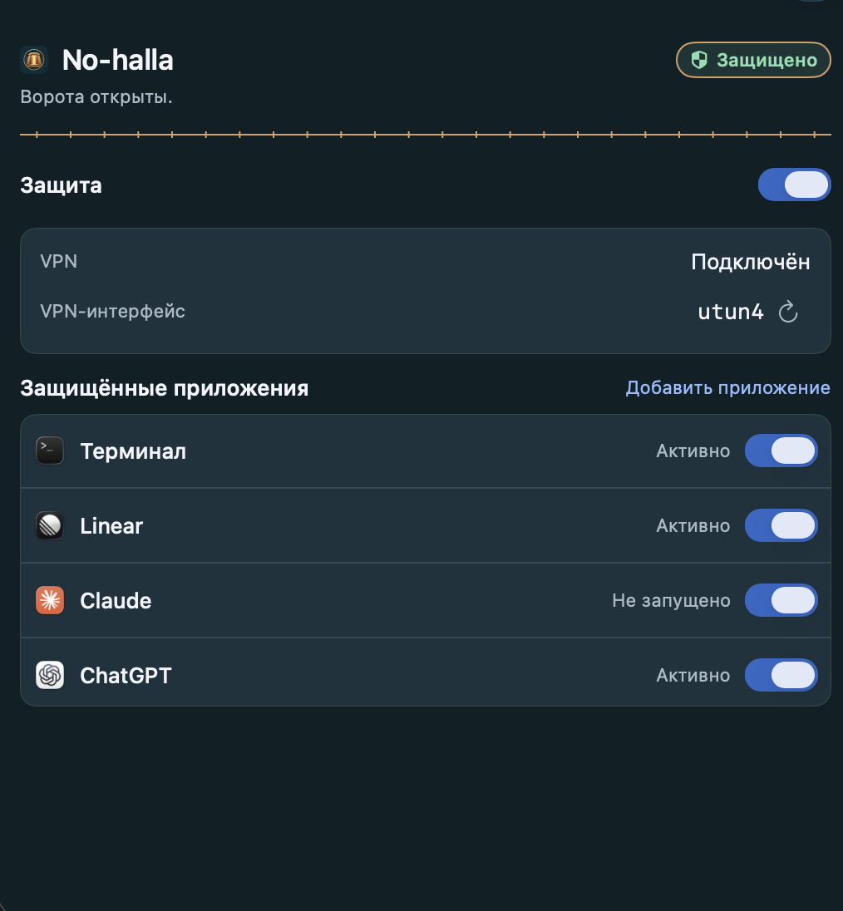

[English](README.md) · **Русский**

# 

**Когда пропадает VPN, No-halla может поставить на паузу целое приложение или только сеансы терминала, в которых работают ИИ-агенты.** Допустим, Codex запущен в Orca, а Claude Code — в стандартном «Терминале» macOS. Если для обоих приложений выбрать «Терминалы агентов», при обрыве VPN оба сеанса встанут на паузу вместе с командами, запущенными агентами. В соседних вкладках без агентов можно по-прежнему собирать проект и работать по SSH. Когда VPN вернётся, агенты продолжат с того же места.

**[Скачать No-halla 0.9.2](https://github.com/Salesao/No-halla/releases/download/v0.9.2/No-halla-0.9.2.dmg)** · [Расширение Chrome](https://chromewebstore.google.com/detail/fnphlcfgnfnfachhcofhggpnhjcibieh) · [Расширение Firefox](https://addons.mozilla.org/en-US/firefox/addon/no-halla-gate/) · [Первый запуск](#первый-запуск) · [Сборка из исходников](docs/USER_GUIDE.ru.md#сборка-из-исходников) · [Решение проблем](docs/USER_GUIDE.ru.md#решение-проблем)

## Расширения для браузеров

Расширения для Chrome и Firefox блокируют список доменов, когда публичный IP не входит в доверенный список. Это самостоятельные артефакты: macOS-приложение для них не нужно, и они не читают его конфигурацию. Оба хранят настройки и последний вердикт локально; единственный внешний запрос — настроенный HTTPS-эндпоинт проверки IP.

### Где взять расширения

- **Chrome Web Store:** [Установить No-halla Gate](https://chromewebstore.google.com/detail/fnphlcfgnfnfachhcofhggpnhjcibieh) (Chrome 121+). Для разработки загрузите `extension/` как unpacked; см. [extension/README.ru.md](extension/README.ru.md).
- **Firefox AMO:** [Установить No-halla Gate](https://addons.mozilla.org/en-US/firefox/addon/no-halla-gate/) (Firefox 140+). Для разработки загрузите `extension-firefox/manifest.json` через `about:debugging`; см. [extension-firefox/README.ru.md](extension-firefox/README.ru.md).
- **Превью для сторов:** [store-assets/README.md](store-assets/README.md) — скриншоты, промо-изображения и тексты для Chrome и AMO.

Оба артефакта версии **1.0.0**, используют общие токены и источник EN/RU-копи. Сборка для Firefox подготовлена к подписи в AMO.

## Защита в работе

| VPN подключён | Публичный IP вне доверенного списка |
| :--- | :--- |
|  |  |

## Установка

Откройте DMG, перетащите **No-halla** в папку **«Программы»** и запустите. Версия 0.9.2 работает на Mac с чипом Apple или процессором Intel под управлением **macOS 13 и новее**. У сборки локальная подпись ad hoc. Если macOS запросит подтверждение первого запуска, откройте **Системные настройки → Конфиденциальность и безопасность**. [Архив ZIP](https://github.com/Salesao/No-halla/releases/download/v0.9.2/No-halla-0.9.2.zip) · [Контрольные суммы SHA-256](https://github.com/Salesao/No-halla/releases/download/v0.9.2/SHA256SUMS.txt)

## Первый запуск

1. **Выберите режим для каждого приложения.** Чтобы заморозить Claude Desktop целиком, выберите **«Приложение»**. Для консольного агента добавьте приложение, в котором вы его запускаете, например Orca или «Терминал», и выберите **«Терминалы агентов»**. [Поддерживаемые агенты](docs/USER_GUIDE.ru.md#терминалы-с-агентами)
2. **Выберите, как проверять соединение.** По умолчанию **«VPN-туннель»** проверяет, активен ли туннель на Mac. Если для работы нужен конкретный публичный IPv4-адрес или диапазон, выберите **«Белый список IP»**. Подключитесь к нужному VPN и нажмите **«Доверять этому IP»**.
3. **Проверьте защиту.** Откройте выбранное приложение и нажмите значок No-halla в строке меню. В режиме «VPN-туннель» отключите VPN и дождитесь статуса **«Заморожено»**. Подключитесь снова — появится **«Защищено»**.

**Что именно останавливается.** Сигнал `SIGSTOP` приостанавливает выполнение кода приложения. При этом macOS может отправить данные из буфера или завершить уже открытое соединение. Запрос, который ИИ-агент успел отправить, может выполниться на сервере. Для блокировки сетевых пакетов нужен межсетевой экран.

[Восстановление и конфиденциальность](docs/USER_GUIDE.ru.md#восстановление-и-конфиденциальность) · [Удаление](docs/USER_GUIDE.ru.md#удаление) · [Лицензия MIT](LICENSE)
